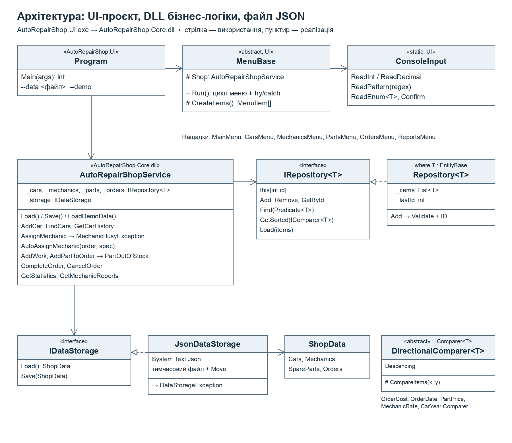
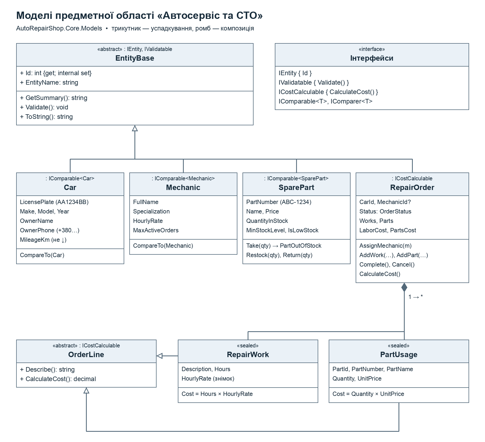
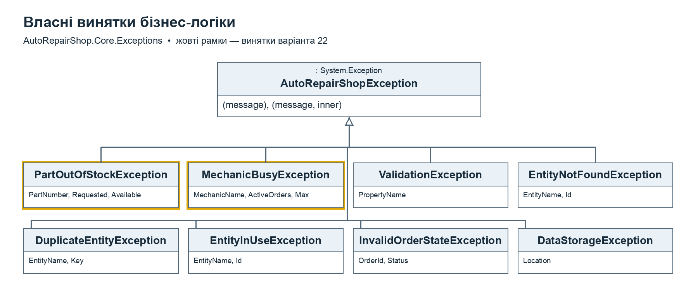

# Курсова робота з ООП — варіант 22: Автосервіс та СТО (Auto Repair Shop)

Консольне застосування C# / .NET 8. Бізнес-логіка — окрема бібліотека **AutoRepairShop.Core.dll**, інтерфейс — консольний проєкт **AutoRepairShop.UI**, дані зберігаються в JSON (System.Text.Json).

| Елемент варіанта | Реалізація |
| --- | --- |
| Сутності | `Car`, `Mechanic`, `SparePart`, `RepairOrder` (+ `RepairWork`, `PartUsage`) |
| Сумарна вартість робіт і запчастин | `RepairOrder.CalculateCost()` = `LaborCost` + `PartsCost`, поліморфно через `OrderLine` |
| Призначення механіка | `AssignMechanic` (вручну), `AutoAssignMechanic` (найменш завантажений потрібної спеціалізації) |
| Власні винятки | `PartOutOfStockException`, `MechanicBusyException` + ще 7 у `Exceptions/` |

## Запуск

~~~bash
dotnet run --project AutoRepairShop.UI -- --demo
~~~

`--demo` — якщо файла ще немає, почати з демонстраційних даних (4 авто, 4 механіки, 8 запчастин, 3 замовлення). Дані: `data/auto-repair-shop.json` (інший файл — `--data шлях.json`). Збереження — при виході (пункт 0) або Ctrl+C.

Швидка демонстрація винятків на демо-даних:

- **MechanicBusyException** — Замовлення → 3 (вручну) → замовлення `3`, механік `2` (Олег Ткаченко, ліміт 1, вже зайнятий);
- **PartOutOfStockException** — Замовлення → 6 → замовлення `3`, запчастина `7` (акумулятор, 1 шт.), кількість `5`.

## Тести

~~~bash
dotnet test
~~~

28 тестів xUnit: моделі, сервіс, збереження/завантаження.

## Структура

~~~text
AutoRepairShop.Core/      DLL: Models, Interfaces, Repositories, Comparers, Exceptions, Services, Storage, Validation
AutoRepairShop.UI/        Program.cs, Menus/ (MenuBase + 6 меню), ConsoleTools/ (ConsoleInput, ConsoleView, Rows)
AutoRepairShop.Tests/     xUnit
~~~

